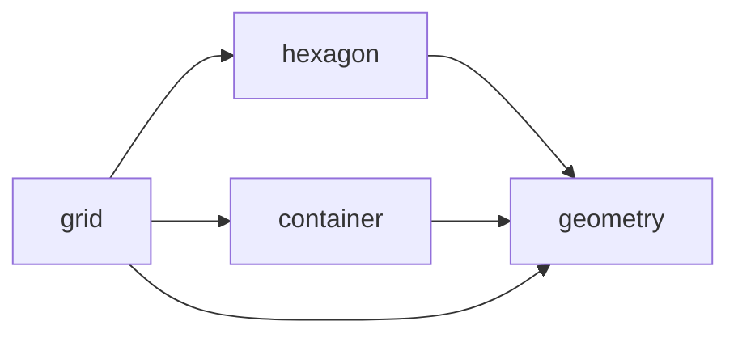

<a href="https://github.com/gravitton">
<picture>
  <source media="(prefers-color-scheme: dark)" srcset="https://raw.githubusercontent.com/gravitton/.github/refs/heads/main/profile/logo-dark.svg">
  <source media="(prefers-color-scheme: light)" srcset="https://raw.githubusercontent.com/gravitton/.github/refs/heads/main/profile/logo-light.svg">
  
</picture>
</a>

[![Stars][ico-stars]][link-repositories]
[![Go Dev Reference][ico-go-dev-reference]][link-go-dev-reference]
[![Go Version][ico-go-version]][link-go]
[![Software License][ico-license]][link-license]

Go libraries for game development

Generic, allocation-conscious and tested to 100% coverage, with results that stay bit-identical
across amd64 and arm64. Every picture below is drawn from the libraries' own results.

## Libraries

### [geometry][link-geometry]

Immutable 2D geometry: points, vectors and shapes with their tests, casts and constructions.

<a href="https://github.com/gravitton/geometry">
<picture>
  <source media="(prefers-color-scheme: dark)" srcset="https://raw.githubusercontent.com/gravitton/geometry/refs/heads/main/docs/images/hero-dark.svg">
  <source media="(prefers-color-scheme: light)" srcset="https://raw.githubusercontent.com/gravitton/geometry/refs/heads/main/docs/images/hero-light.svg">
  
</picture>
</a>

### [hexagon][link-hexagon]

Hexagonal grid math: coordinates, rings, lines, line of sight and field of view.

<a href="https://github.com/gravitton/hexagon">
<picture>
  <source media="(prefers-color-scheme: dark)" srcset="https://raw.githubusercontent.com/gravitton/hexagon/refs/heads/main/docs/images/hero-dark.svg">
  <source media="(prefers-color-scheme: light)" srcset="https://raw.githubusercontent.com/gravitton/hexagon/refs/heads/main/docs/images/hero-light.svg">
  
</picture>
</a>

### [grid][link-grid]

2D grids with rectangular, isometric and hexagonal layouts, range and sight queries, and
pathfinding.

<a href="https://github.com/gravitton/grid">
<picture>
  <source media="(prefers-color-scheme: dark)" srcset="https://raw.githubusercontent.com/gravitton/grid/refs/heads/main/docs/images/hero-dark.svg">
  <source media="(prefers-color-scheme: light)" srcset="https://raw.githubusercontent.com/gravitton/grid/refs/heads/main/docs/images/hero-light.svg">
  
</picture>
</a>

### Also

- [container][link-container]: generic containers, a table of values per index and an
  immutable sorted set.
- [assert][link-assert]: lightweight test assertions.
- [errors][link-errors]: a drop-in superset of `errors` with fields, stack traces and
  multi-errors.

## Contributing

Bug reports and proposals are welcome in each library's issues. Please see
[Contributing][link-contributing] before opening a pull request, and [Security][link-security]
to report a vulnerability.

## License

Every library is released under the MIT License, in the `LICENSE.md` of its repository.

[ico-stars]:                https://img.shields.io/github/stars/gravitton?style=flat-square&color=e8883a
[ico-go-version]:           https://img.shields.io/github/go-mod/go-version/gravitton/geometry?style=flat-square&color=007d9c
[ico-go-dev-reference]:     https://img.shields.io/badge/go.dev-reference-007d9c?style=flat-square
[ico-license]:              https://img.shields.io/badge/license-MIT-lightgrey?style=flat-square

[link-repositories]:        https://github.com/orgs/gravitton/repositories
[link-go]:                  https://go.dev/doc/devel/release
[link-go-dev-reference]:    https://pkg.go.dev/search?q=github.com%2Fgravitton
[link-license]:             https://github.com/gravitton/geometry/blob/main/LICENSE.md
[link-contributing]:        https://github.com/gravitton/.github/blob/main/CONTRIBUTING.md
[link-security]:            https://github.com/gravitton/.github/blob/main/SECURITY.md
[link-geometry]:            https://github.com/gravitton/geometry
[link-hexagon]:             https://github.com/gravitton/hexagon
[link-grid]:                https://github.com/gravitton/grid
[link-container]:           https://github.com/gravitton/container
[link-assert]:              https://github.com/gravitton/assert
[link-errors]:              https://github.com/gravitton/errors
